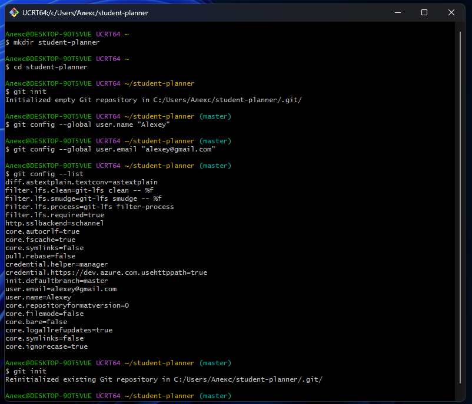
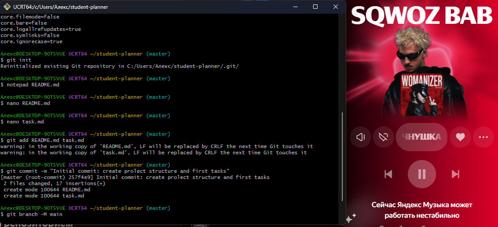
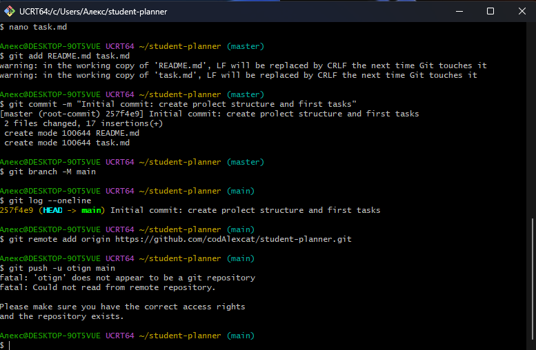
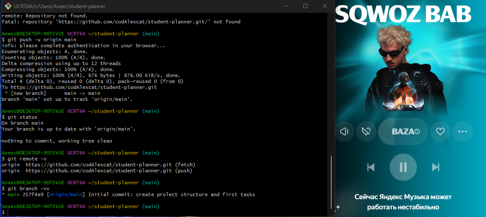
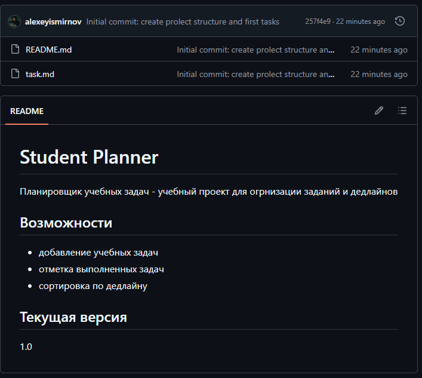
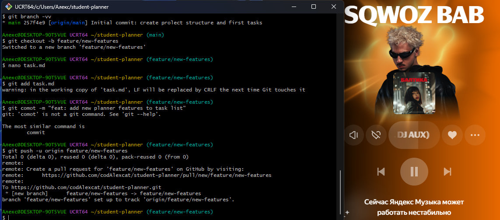
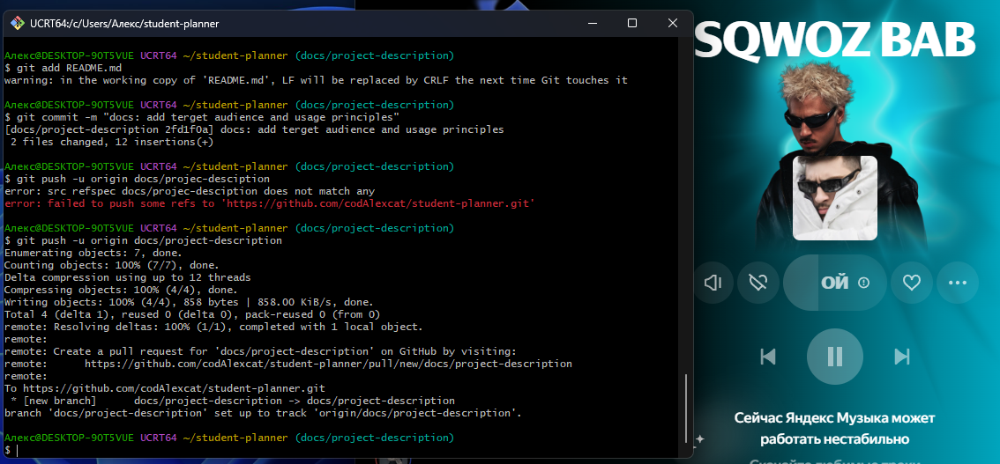
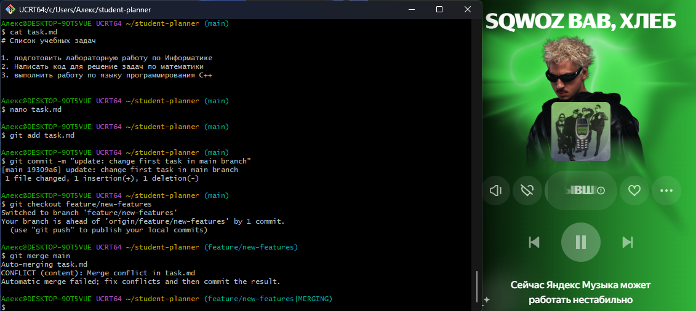
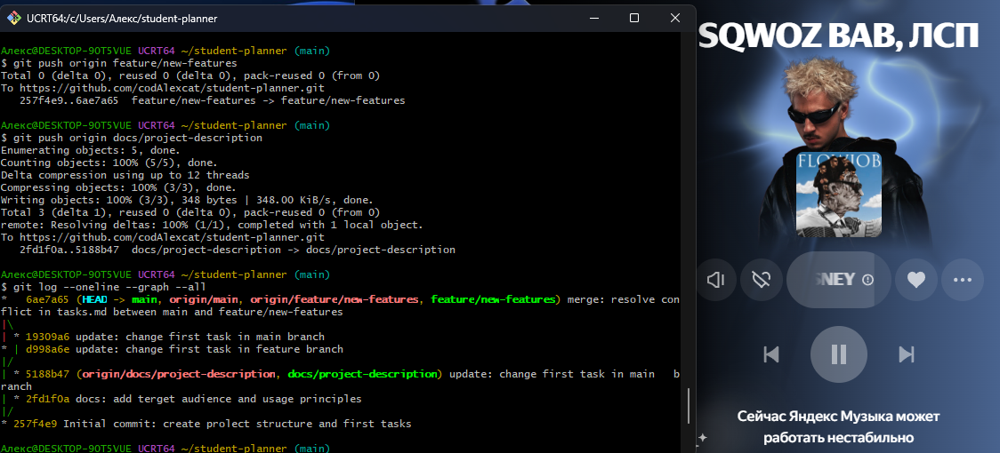
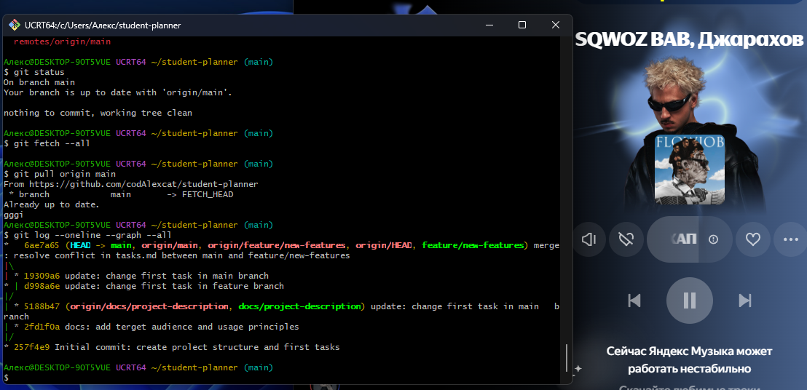

# Отчёт по практической работе №4

**Кто делал:** Графов Алексей

**Где лежит:** https://github.com/codAlexcat/student-planner

---

## 1. Список выполненых шагов

1. Создал папку `student-planner`, инициализировал в ней Git.
2. Настроил имя и почту для коммитов.
3. Сделал `README.md` и `task.md`, закоммитил первый раз.
4. Переименовал основную ветку в `main`.
5. Завёл репозиторий на GitHub и связал его с локальным.
6. Создал ветку `feature/new-features` — добавил новые возможности планировщика в `task.md`.
7. Создал ветку `docs/project-description` — дописал в README про целевую аудиторию и правила использования.
8. Специально сделал конфликт: одну и ту же задачу поменял по-разному в `main` и в `feature/new-features`.
9. Разрешил конфликт руками, слил ветку в `main`, всё запушил.
10. Проверил историю, ветки и состояние репозитория.

---

## 2. Скриншоты по ходу дела

### 2.1. Инициализация репозитория



### 2.2. Первый коммит и переименование ветки



### 2.3. Связка с удалённым репозиторием



### 2.4. Успешный пуш и проверка привязки



### 2.5. Страница репозитория на GitHub



### 2.6. Ветка с новыми возможностями



### 2.7. Ветка с документацией



---

## 3. Конфликт и его решение

### 3.1. Что случилось

- в `main`: «Подготовить презентацию по информатике»;
- в `feature/new-features`: «Подготовить отчёт по практике».

Когда я попробовал слить `main` в `feature/new-features`, Git не понял, какую версию оставить, и выдал конфликт



### 3.2. Как выглядел файл

В `task.md` появились маркеры:

```
<<<<<<< HEAD
1. Подготовить отчёт по практике
=======
1. Подготовить презентацию по информатике
>>>>>>> main
```

### 3.3. Что я сделал

Открыл файл, удалил маркеры и оставил один согласованный вариант — «Подготовить презентацию по информатике». После этого:

```bash
git add task.md
git commit -m "merge: resolve conflict in task.md between main and feature/new-features"
```

Затем слил `feature/new-features` в `main` и запушил:

```bash
git checkout main
git merge feature/new-features
git push origin main
```

---

## 4. Проверка истории и веток

### 4.1. Пуш веток и граф коммитов

Видно, что обе ветки ушли на GitHub, а история содержит развилку и merge-коммит.



### 4.2. Финальная проверка

`git fetch`, `git pull`, список веток и состояние рабочего каталога.



---

## 5. Какие коммиты получились

- Конфликт был. Он разрешён, отдельным коммитом.
- В итоговой версии есть и новые возможности планировщика, и согласованная первая задача.
- В `README.md` есть раздел про целевую аудиторию и принципы использования.
- Всё лежит в `main` и отправлено на GitHub.

Ссылка на репозиторий: https://github.com/codAlexcat/student-planner